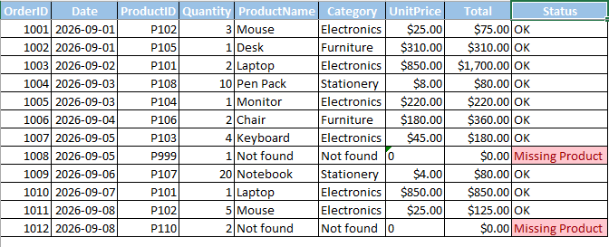
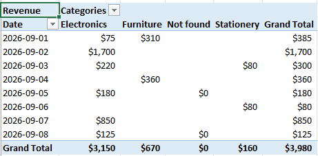

# excel-xlookup-sales-analysis

## GOAL

The main goal of this spreadsheet is to find orders whose product IDs are not listed in the Product sheet. I used a mix of XLOOKUP and PivotTables on this sample and the same method can be scaled to thousands of rows. I chose XLOOKUP because it highlights IDs that do not match any record in the Products sheet.

## DATA

This sample has two sheets. The Products sheet includes product ID, name, category and price. The Orders sheet has Order ID, date, ProductID and quantity as the data. Product name, category, unit price, total and status are calculated columns. Most of these are built using XLOOKUP. The total is calculated with a formula that multiplies quantity by unit price.

## TECHNIQUES

- XLOOKUP with "Not found"

- Left-lookup by product name

- Multicolumn spill

- Total column (Quantity × UnitPrice)

- Status flag

- PivotTable

## FINDINGS

The PivotTable groups data by category in columns and by date in rows. It shows revenue totals. Electronics made $3,150 out of the $3,980 total, which is about 79%. 2 of the 12 orders used product IDs P999 and P110, which did not appear in the Products sheet. The Status column marked both as "Missing product". All other orders show "OK".

## PROBLEM I SOLVED

While setting up XLOOKUP the lookup failed to find matches. The issue was that the Orders sheet showed P102 as the product ID but the actual value stored was 102 because I had applied a custom cell format that adds a "P" in front of numbers. The Products sheet stored the full text P102 so Excel compared a number to text and found no match. I discovered this by clicking the cell and checking the formula bar, which showed 102 instead of P102. I fixed it by removing the “P” from the product IDs in the Products sheet, so both sheets store plain numbers and the lookup matches them. I kept the custom cell format in Orders so the IDs still display as P102.

